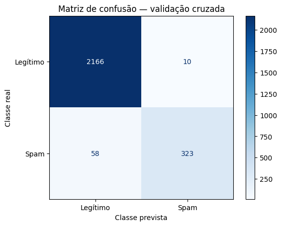
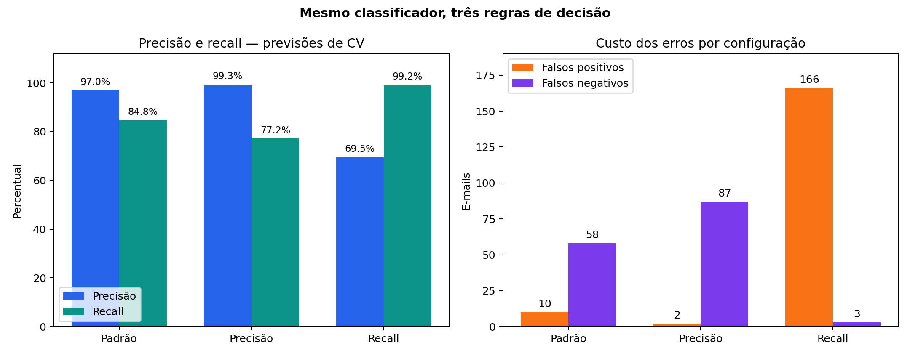
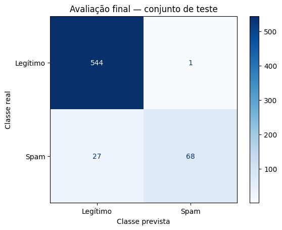
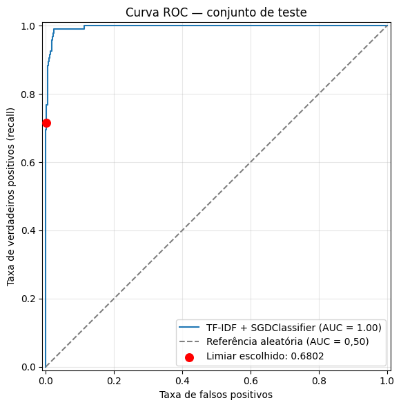

# SpamKiller

**Classificação de e-mails com TF-IDF e regressão logística treinada via SGD.**

Projeto de aprendizado de máquina para classificar e-mails como **legítimos (0)** ou **spam (1)** e investigar como o limiar de decisão altera o custo dos erros. O trabalho abrange leitura de mensagens MIME, limpeza textual, auditoria de dados, representação TF-IDF, validação cruzada estratificada, seleção de limiares, avaliação em teste e exportação para inferência.

**Resultado principal:** na configuração que prioriza precisão, o teste de 640 e-mails apresentou **98,55% de precisão**, **71,58% de recall**, **82,93% de F1** e **1 mensagem legítima marcada como spam**. A meta de 99% de precisão usada na seleção não foi atingida no teste.

São disponibilizados dois arquivos de modelo, mas **não são dois treinamentos distintos**: ambos contêm o mesmo pipeline ajustado, com regras de decisão diferentes. O modo de recall é um experimento complementar, sem avaliação independente no teste.

## Navegação

- [Início rápido](#início-rápido)
- [Dados e preparação](#dados-e-preparação)
- [Pré-processamento e vazamento](#pré-processamento-e-vazamento)
- [Modelo e validação](#modelo-e-validação)
- [Decisão entre precisão e recall](#decisão-entre-precisão-e-recall)
- [Avaliação final e ROC](#avaliação-final-e-roc)
- [Bibliotecas e ambiente](#bibliotecas-e-ambiente)
- [Estrutura e persistência](#estrutura-e-persistência)
- [Reprodução e limitações](#reprodução-e-limitações)

## Início rápido

Os modelos treinados já estão disponíveis no repositório. Para executar a inferência, não é necessário baixar o corpus nem refazer o treinamento.

### Instalar e executar o exemplo

Use um ambiente Python compatível com as versões registradas na exportação, especialmente para carregar funções serializadas por cloudpickle. A partir do terminal:

```bash
git clone https://github.com/EduSoBarbosa/SpamKiller.git
cd SpamKiller
python3 -m venv .venv
source .venv/bin/activate
python -m pip install -r modelos/requirements.txt
python modelos/usar_modelo.py
```

Para também trabalhar no notebook localmente:

```bash
python -m pip install -r requirements-notebook.txt
python -m jupyter lab
```

### Classificar assunto e corpo em texto simples

Na raiz do projeto, em um script ou sessão Python:

```python
from modelos.usar_modelo import carregar, classificar
pacote, funcoes = carregar("precisao")  # ou "recall"
resultado = classificar(
    assunto="Meeting tomorrow",
    corpo="Hi team, our project meeting is tomorrow at 10 AM.",
    pacote=pacote,
    funcoes=funcoes
)
print(resultado)
```

O retorno inclui classe, rótulo, estimativa de probabilidade, limiar e configuração. Para comparar modos, carregue cada pacote e classifique a mesma mensagem; as probabilidades devem coincidir, embora a decisão possa mudar.

### Classificar um arquivo de e-mail bruto

```python
from modelos.usar_modelo import carregar, classificar_arquivo
pacote, funcoes = carregar("precisao")
resultado = classificar_arquivo("mensagem.eml", pacote, funcoes)
print(resultado)
```

`classificar()` pressupõe corpo já em texto simples. Para HTML e MIME, use a leitura do arquivo bruto, que aplica `processar_email()`. Não refaça `fit()` ou `fit_transform()` ao prever uma mensagem.

## Dados e preparação

O notebook utiliza os arquivos `20030228_easy_ham.tar.bz2`, `20030228_hard_ham.tar.bz2` e `20030228_spam.tar.bz2` do corpus SpamAssassin. As pastas `easy_ham` e `hard_ham` recebem rótulo 0; `spam` recebe rótulo 1. Os dados brutos não estão versionados neste repositório. Para reproduzir o treinamento, obtenha esses arquivos na [fonte oficial do corpus SpamAssassin](https://spamassassin.apache.org/old/publiccorpus/) e coloque-os no diretório de trabalho do notebook.

A inspeção inicial identificou um arquivo auxiliar `cmds` em cada pasta. A versão final de `carregar_pasta()` os ignora. Após essa exclusão, o notebook registrou 3.250 mensagens, nenhum valor ausente, nenhum texto vazio e 53 duplicatas de texto processado. Não foram encontrados textos idênticos com rótulos conflitantes. Após a deduplicação, restaram 3.197 mensagens.

| Etapa | Legítimos (0) | Spam (1) | Total |
| --- | --- | --- | --- |
| Antes da deduplicação | 2750 | 500 | 3250 |
| Após a deduplicação | 2721 | 476 | 3197 |
| Treino | 2176 | 381 | 2557 |
| Teste | 545 | 95 | 640 |

Dados da tabela: [CSV](gráficos/distribuicao_dados.csv)

As contagens após a limpeza e por partição foram consolidadas a partir das matrizes e dos totais registrados: 2.721 legítimos e 476 spams, aproximadamente 85,11% e 14,89%. O desbalanceamento exige analisar a classe spam separadamente: prever sempre a classe majoritária já produziria cerca de 85% de acurácia, sem detectar spam algum.

A divisão foi feita por `train_test_split(test_size=0.20, random_state=42, stratify=df["label"])`: 2.557 exemplos de treino e 640 de teste. A estratificação preserva aproximadamente as proporções; não balanceia as classes em 50/50. A interseção de textos idênticos entre treino e teste foi zero.

## Pré-processamento e vazamento

| Função | Responsabilidade |
| --- | --- |
| limpar_texto | Substitui URLs por URL e endereços por EMAIL; normaliza espaços |
| limpar_assunto | Remove marcações explícitas de spam previstas na regex; chama limpar_texto |
| extrair_corpo | Percorre MIME; extrai texto simples e HTML convertido; ignora partes marcadas como anexo |
| processar_email | Lê bytes com BytesParser; une assunto e corpo tratados |
| carregar_pasta | Ignora cmds e diretórios; associa o texto não vazio ao rótulo da pasta |

Dados da tabela: [CSV](gráficos/funcoes_preprocessamento.csv)

O modelo recebe **assunto + corpo**, sem incorporar os demais cabeçalhos externos. Isso exclui da entrada cabeçalhos como `X-Spam-Status`, `X-Spam-Flag`, `Received` e `Message-ID`, que poderiam introduzir decisões prévias de filtros ou características específicas da coleta. As marcações reconhecidas no assunto, como `[SPAM]` e `***SPAM***`, também são removidas.

A limpeza preserva as demais palavras, números e pontuação; não aplica stemming, lematização nem remoção explícita de stopwords. URLs e endereços são substituídos por marcadores, preservando sua presença e descartando detalhes. A tokenização posterior do TF-IDF modifica essa representação: usa minúsculas e, por padrão, termos alfanuméricos com pelo menos dois caracteres; não modela pontuação como característica isolada.

**Limites do pré-processamento:** versões alternativas HTML e texto simples são concatenadas e podem repetir conteúdo. `except: pass` pode ocultar falhas; assinaturas, citações e mensagens encaminhadas permanecem. Ignorar uma parte MIME marcada como anexo não garante a exclusão de todos os descendentes de um anexo multipartes. A extração HTML remove atributos como `href`, perdendo sinais de domínio. A função não multipartes não restringe explicitamente a extração a texto.

Essas regras são fixas e podem ser aplicadas antes da divisão. Já o vocabulário e os pesos IDF são aprendidos **dentro do pipeline**, somente no treino de cada fold. A deduplicação exata ajuda, mas não impede compartilhamento de campanhas ou conversas quase idênticas entre partições.

## Modelo e validação

### Representação TF-IDF

Cada e-mail é uma linha e cada termo do vocabulário é uma coluna de uma matriz esparsa. TF mede a frequência no documento; IDF reduz a importância de termos encontrados em muitos documentos. O vetor é normalizado em norma L2. Um peso alto não significa spam: o TF-IDF não usa os rótulos; o classificador aprende as associações.

Foi usado `TfidfVectorizer()` com parâmetros padrão, incluindo unigramas, conversão para minúsculas, IDF suavizado e normalização L2. Vocabulário e IDF ficam armazenados no pipeline; termos desconhecidos em novas mensagens são ignorados.

### Classificador

```python
modelo = Pipeline([
    ("tfidf", TfidfVectorizer()),
    ("classificador", SGDClassifier(
        loss="log_loss", max_iter=1000,
        tol=1e-3, random_state=42
    ))
])
```

SGD é o otimizador. Com `loss="log_loss"`, o classificador é uma regressão logística linear treinada por descida de gradiente estocástica. `max_iter=1000` limita passagens pelos dados; `tol=1e-3` participa do critério de parada. Os demais parâmetros foram mantidos no padrão, sem busca de hiperparâmetros ou calibração explícita das probabilidades.

### Validação cruzada inicial

Foram usados 5 folds com `StratifiedKFold(n_splits=5, shuffle=True, random_state=42)`. Cada ajuste usa quatro partes para treino e uma para validação. `cross_validate` retorna métricas; `cross_val_predict` refaz os ajustes para gerar uma previsão fora do treino para cada exemplo. Essas funções avaliam cópias e não deixam automaticamente a variável `modelo` ajustada.

| Métrica (spam) | Média | Desvio entre folds |
| --- | --- | --- |
| Precisão | 0,9701 | 0,0189 |
| Recall | 0,8478 | 0,0306 |
| F1 | 0,9045 | 0,0208 |

Dados da tabela: [CSV](gráficos/metricas_cv_media_desvio.csv)

Os desvios acima descrevem a variação entre folds; não são intervalos de confiança. Precisão, recall e F1 usam spam (1) como classe positiva.



Linhas são classes reais; colunas são classes previstas. No padrão foram 2.166 verdadeiros negativos, 10 falsos positivos, 58 falsos negativos e 323 verdadeiros positivos. [Contagens em CSV](gráficos/matriz_confusao_cv.csv).

A precisão é VP/(VP+FP), recall é VP/(VP+FN), e F1 é 2VP/(2VP+FP+FN). Métricas calculadas sobre a matriz agregada podem diferir um pouco da média por fold.

## Decisão entre precisão e recall

As pontuações vieram de `cross_val_predict(..., method="predict_proba")[:, 1]` no conjunto de treino. `precision_recall_curve` forneceu opções de limiar; seu último ponto, sem limiar correspondente, foi descartado na seleção.

**Precisão:** entre os limiares com precisão de pelo menos 99%, escolheu-se o de maior recall. Valor completo salvo: `0.6802033645696416`.

**Recall:** entre os limiares com recall de pelo menos 99%, escolheu-se o de maior precisão; desempate por maior recall e maior limiar. Valor completo salvo: `0.08088615891814067`.

| Configuração | Limiar | Precisão | Recall | VN | FP | FN | VP |
| --- | --- | --- | --- | --- | --- | --- | --- |
| Padrão | 0,500000 | 97,00% | 84,78% | 2166 | 10 | 58 | 323 |
| Prioriza precisão | 0,680203 | 99,32% | 77,17% | 2174 | 2 | 87 | 294 |
| Prioriza recall | 0,080886 | 69,49% | 99,21% | 2010 | 166 | 3 | 378 |

Dados da tabela: [CSV](gráficos/comparacao_limiares_cv.csv)



Esses números são da **seleção nas previsões de validação cruzada**, não avaliações independentes dos limiares escolhidos. Não devem ser apresentados como resultados de teste.

No modo de precisão, 8 mensagens legítimas adicionais são preservadas em relação ao padrão, mas 29 spams adicionais passam. No modo de recall, em relação ao de precisão, são detectados 84 spams adicionais e bloqueadas 164 mensagens legítimas adicionais. Dos 544 alertas do modo recall, 166 (30,51%) eram legítimos; sobre os 2.176 legítimos existentes, a taxa de falsos positivos foi 7,63%.

Elevar o limiar torna o bloqueio mais exigente; não altera os pesos nem aumenta a certeza intrínseca do modelo. Uma mensagem abaixo do corte apenas não atingiu o critério de spam — isso não comprova que seja segura. Precisão também não é igual ao limiar ou à pontuação de uma mensagem.

Priorizar precisão faz sentido quando atrasar ou perder mensagens importantes tem custo elevado. Priorizar recall pode ser adequado para triagem ou quarentena com revisão e capacidade para lidar com falsos alarmes. **Spam não é sinônimo de golpe**: validar um detector de phishing exigiria dados e rótulos específicos. Não há garantia de detecção total em mensagens futuras.

## Avaliação final e ROC

Após fixar o limiar de precisão, o pipeline foi ajustado com todo o treino. No teste, utilizou-se `predict_proba()` e comparação explícita com esse limiar. Chamar somente `predict()` não aplica a regra personalizada.

| Indicador | Resultado |
| --- | --- |
| Precisão | 98,55% |
| Recall | 71,58% |
| F1 | 82,93% |
| Verdadeiros negativos | 544 |
| Falsos positivos | 1 |
| Falsos negativos | 27 |
| Verdadeiros positivos | 68 |
| Taxa de falsos positivos | 0,18% |

Dados da tabela: [CSV](gráficos/metricas_teste.csv)



[Contagens da matriz em CSV](gráficos/matriz_confusao_teste.csv).

Dos 545 legítimos, 544 foram preservados. Dos 95 spams, 68 foram detectados e 27 passaram (28,42%). Entre 69 mensagens bloqueadas, 68 eram spam: precisão de 98,55%. A meta de 99% da seleção não se repetiu. O recall passou de 77,17% na seleção para 71,58% no teste. A diferença não prova overfitting isoladamente; a seleção pode ser otimista e a amostra de teste é limitada.

### Curva ROC



O eixo horizontal mostra FP/(FP+VN), a taxa de falsos positivos; o vertical mostra o recall. O ponto vermelho corresponde ao limiar escolhido: aproximadamente 0,18% de falsos positivos e 71,58% de recall. A diagonal representa ordenação aleatória; proximidade do canto superior esquerdo indica boa separação nesta amostra.

A legenda original exibe **AUC = 1,00 com arredondamento para duas casas**. Isso não comprova uma AUC exatamente igual a 1, nem classificação perfeita. A AUC mede ordenação ao variar o limiar; a precisão e a matriz descrevem um corte específico. O valor numérico completo e as pontuações individuais não foram exportados; por isso o README mantém apenas o valor arredondado apresentado na figura. A imagem foi extraída diretamente do notebook.

### Exemplo manual

O notebook também cria uma mensagem fictícia em inglês com promessa de prêmio, urgência, cobrança antecipada e solicitação de informações sensíveis. Após a limpeza, o modelo atribuiu **98,34% de probabilidade estimada de spam**, acima do corte, classificando-a como **SPAM**. Esse exemplo demonstra inferência; não integra as métricas do corpus nem valida generalização.

## Bibliotecas e ambiente

| Biblioteca / ambiente | Versão registrada | Uso |
| --- | --- | --- |
| Python | 3.13.16 | Linguagem e biblioteca padrão |
| NumPy | 2.1.3 | Vetores, limiares e verificações numéricas |
| pandas | 2.2.3 | DataFrames, limpeza e tabelas |
| scikit-learn | 1.6.1 | TF-IDF, SGD, pipeline, validação e métricas |
| SciPy | 1.16.3 | Suporte numérico e matrizes esparsas |
| Beautiful Soup | 4.13.5 | Extração de texto do HTML |
| Matplotlib | Não registrada na exportação | Matrizes de confusão e curva ROC |
| joblib | 1.6.0 | Persistência dos pipelines |
| cloudpickle | 3.1.2 | Persistência das funções do notebook |
| Jupyter / IPython | Não registrada | Execução interativa e display |
| google.colab | Ambiente Colab | Download do ZIP no notebook |

Dados da tabela: [CSV](gráficos/bibliotecas.csv)

Módulos da biblioteca padrão usados incluem `os`, `tarfile`, `re`, `email.policy`, `email.parser.BytesParser`, `pathlib`, `datetime`, `importlib.metadata`, `json`, `platform` e `shutil`. Eles não exigem instalação separada.

O ambiente registrado na exportação é Python **3.13.16**. As versões indicadas correspondem aos metadados de exportação dos modelos; não constituem uma validação de compatibilidade em outros ambientes. Matplotlib e Jupyter não tiveram versões registradas; o arquivo complementar os inclui sem fixação, logo não representa um lock completo de reprodução.

## Estrutura e persistência

| Caminho | Conteúdo |
| --- | --- |
| README.md | Documentação e interpretação dos resultados |
| `Classificação_de_Spamipynb(1).ipynb` | Notebook com preparação, experimentos, avaliação e exportação |
| modelos/spam_precisao.joblib | Pipeline treinado e limiar de precisão |
| modelos/spam_recall.joblib | Mesmo pipeline e limiar de recall |
| modelos/preprocessamento.pkl | Funções de limpeza serializadas |
| modelos/metadados.json | Versões, limiares completos e métricas |
| modelos/requirements.txt | Dependências fixadas na exportação original |
| modelos/usar_modelo.py | Funções de carregamento e inferência |
| requirements-notebook.txt | Dependências adicionais para executar o notebook localmente |
| gráficos/ | Imagens e todas as tabelas do README em CSV e Markdown |
| `SHA256SUMS.txt` | Manifesto de integridade da exportação original; deve ser atualizado quando arquivos listados forem alterados |

Dados da tabela: [CSV](gráficos/inventario.csv)

Os modelos, as funções de inferência e os metadados estão em `modelos/`. As figuras e tabelas de apoio ficam em `gráficos/`. Os resultados apresentados correspondem às saídas registradas no notebook e aos metadados dos modelos. O gráfico comparativo de limiares usa essas contagens; não representa um treinamento adicional.

### Persistência

Cada `.joblib` guarda o pipeline, o limiar completo, a classe positiva, o mapeamento de rótulos e a versão do artefato. `preprocessamento.pkl` guarda as quatro funções necessárias à limpeza externa ao pipeline. `metadados.json` mantém métricas e versões; o modo recall aparece com teste `null`, pois não foi avaliado independentemente.

O notebook registra uma verificação de carregamento dos dois pacotes: as probabilidades em dez textos de treino foram comparadas às do pipeline em memória e os limiares foram conferidos. Essa verificação de persistência não substitui a avaliação em dados não vistos.

Carregue arquivos pickle/joblib somente de origem confiável: a desserialização pode executar código. A compatibilidade desses formatos depende do ambiente; cloudpickle não substitui o código-fonte legível preservado no notebook.

## Reprodução e limitações

Para refazer o experimento, obtenha os três arquivos do corpus indicados acima e coloque-os no diretório de trabalho do notebook. Execute as células em ordem: extração, limpeza, auditoria, deduplicação, divisão, validação, seleção de precisão, ajuste final, teste, demonstração/ROC, exploração de recall e exportação. A última célula usa `google.colab.files.download`; em Jupyter local, remova apenas essa chamada e copie o ZIP gerado.

A ordem de `os.listdir()` não é garantida. O `random_state` reproduz a divisão somente se conteúdo e ordem dos exemplos também forem iguais. Índices das partições, textos processados e vetores individuais de pontuações não foram exportados, limitando a reconstrução exata dos resultados. Para uma nova versão, registre ordem de arquivos, hashes do corpus e índices das partições antes de treinar.

O notebook original contém uma observação antiga dizendo que arquivos auxiliares não são diferenciados; o código atual já exclui `cmds`. Este README descreve a implementação efetiva. Também há um aviso sobre a política de extração do `tarfile`: use arquivos de origem confiável e revise o filtro de extração para sua versão de Python antes de executar.

Outras limitações:

- Corpus histórico, com exemplos demonstrados em inglês; desempenho em português ou mensagens atuais não foi estabelecido.

- Deduplicação exata, sem agrupamento por conversa, remetente ou campanha; mensagens quase iguais podem atravessar partições.

- Texto simples/HTML pode ser contado duas vezes; erros de parsing podem ser silenciosos.

- Sem estudo de calibração, intervalos de confiança, busca de hiperparâmetros ou comparação com outros algoritmos.

- Resultados dos limiares na CV são de seleção; a configuração de recall foi explorada depois de o teste ter sido observado e não possui confirmação independente.

- ROC AUC alta não implica precisão perfeita, segurança ou detecção específica de fraudes.

- Os dados brutos não estão versionados e o ambiente não possui um lock completo. Consulte os termos da fonte antes de redistribuir o corpus.

Como evolução, é possível melhorar a extração MIME, registrar falhas, separar campanhas entre partições e avaliar em outro corpus reservado. Novas escolhas devem usar treino/validação; o teste já observado não deve servir para ajustar versões e continuar sendo anunciado como avaliação final independente.

## Fonte dos dados e autoria

Projeto desenvolvido por [Eduardo Barbosa](https://github.com/EduSoBarbosa), com dados do [corpus público do Apache SpamAssassin](https://spamassassin.apache.org/old/publiccorpus/). Este é um projeto independente de estudo e não implica afiliação ou endosso da Apache Software Foundation.

As métricas e tabelas documentam os experimentos registrados no notebook e nos metadados dos modelos. Nenhum dado sintético foi incluído no treinamento; a mensagem fictícia aparece apenas como demonstração de inferência.
